# EJERCICIO 2A. Importación, configuración y despliegue del tema Lagrange en GitHub Pages

**Alumno:** Rubén Marcos Cuadrado Ugbomah 
**Repositorio:** `actividad21-2A`  
**Tema:** Lagrange  
**URL:** `https://rubenasir2.github.io/actividad21-2A.git/`

## 1. Importación del tema Lagrange

Para esta práctica he elegido Lagrange, un tema de Jekyll orientado a la creación de blogs personales. Se trata de un tema de código abierto que permite modificar tanto su contenido como su configuración y diseño.

Repositorio original:
https://github.com/LeNPaul/Lagrange

Para importar el tema voy a utilizar la opción de *Fork*, creando una copia del repositorio original en mi cuenta de GitHub.

Los pasos que sigo son:

1. Accedo al repositorio original de Lagrange en GitHub.
2. Pulso el botón **Fork**.
3. Selecciono mi cuenta como destino.
4. Una vez creado el fork, cambio el nombre del repositorio a `actividad21-2A` desde sus opciones de configuración.
5. Compruebo que el repositorio se encuentra en mi cuenta.

De esta forma dispongo de una copia independiente del tema sobre la que puedo trabajar.

### 1.1. Clonar el repositorio en local

Una vez creado el repositorio en GitHub, lo clono en mi equipo para poder trabajar con los archivos del tema.

Desde una terminal ejecuto:

```bash
git clone https://github.com/USUARIO/actividad21-2A.git
```

Accedo al directorio:

```bash
cd actividad21-2A
```

Compruebo que se han descargado los archivos y directorios del proyecto.

### 1.2. Instalar las dependencias

Antes de realizar modificaciones, instalo las dependencias del proyecto mediante Bundler:

```bash
bundle install
```

Una vez finalizada la instalación, arranco el servidor local de Jekyll:

```bash
bundle exec jekyll serve
```

Accedo desde el navegador a:

```text
http://localhost:4000
```

Compruebo que el tema se muestra correctamente y que puedo navegar por las distintas secciones.

**Captura 1:** mostrar el repositorio Lagrange importado en mi cuenta de GitHub.
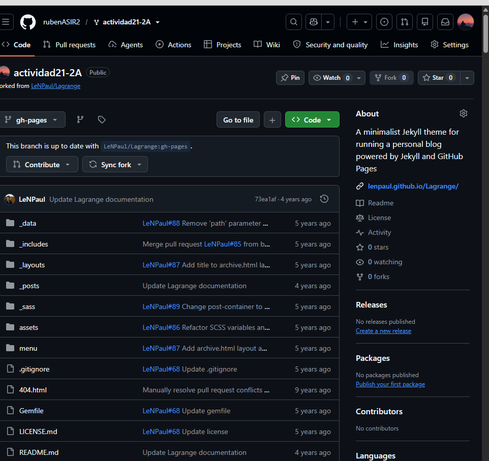

**Captura 2:** mostrar la clonación del repositorio y la instalación de dependencias.

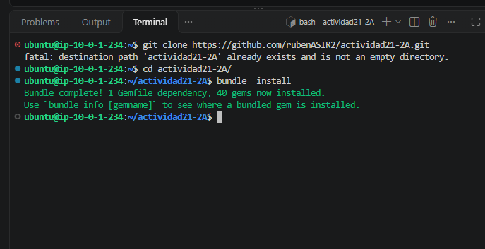

---

## 2. Configuración y personalización del tema Lagrange

Una vez importado el tema y comprobado que funciona correctamente, comienzo a personalizarlo para adaptarlo al contenido de mi blog.

Voy a mantener la misma temática del ejercicio 1A, centrada en la administración de servidores web, Apache, Nginx y Docker.

### 2.1. Configurar el archivo `_config.yml`

Abro el archivo de configuración situado en la raíz del proyecto:

```bash
cd ~/actividad21-2A
nano _config.yml
```

Localizo los parámetros principales y sustituyo los valores originales por los datos de mi blog (cambio un poco el titulo y algunas cosas para variar)

```yaml
title: "Administración de servidores web"
description: "Prácticas sobre Apache, Nginx, Docker y despliegue de aplicaciones"
author: "Rubén Marcos Cuadrado"

url: "https://rubenasir2.github.io"
baseurl: "/actividad21-2A"

github:
  url: "https://rubenasir2.github.io/actividad21-2A"
```

Sustituyo `USUARIO` por mi nombre de usuario de GitHub.

La configuración establece el nombre del sitio, el autor y las direcciones utilizadas para generar los enlaces y cargar los recursos.

Al ser un repositorio de proyecto, `baseurl` debe contener `/actividad21-2A`. La propiedad `github.url` se utiliza en las plantillas originales de Lagrange para construir las rutas completas.

Mantengo el resto de las opciones originales, especialmente los plugins y los parámetros de compilación.

Guardo los cambios con `Ctrl + O` y salgo con `Ctrl + X`.

**Captura 3. Configuración de `_config.yml`.**

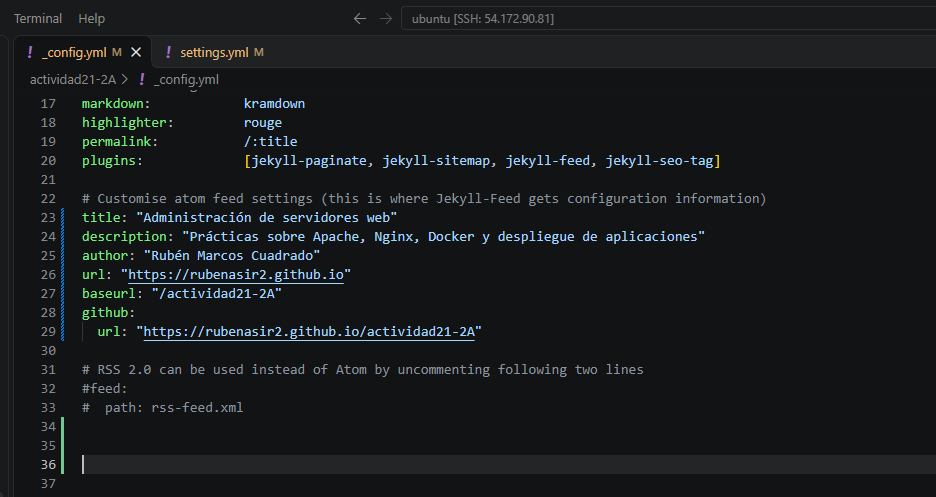

### 2.2. Configurar el menú de navegación

El menú y otros elementos del tema se configuran desde:

```bash
nano _data/settings.yml
```

Modifico los apartados correspondientes para dejar el menú y las opciones principales de esta forma:

```yaml
# Comentarios desactivados
disqus:
  comments: false
  disqus_shortname: ''

# Google Analytics desactivado
google-ID: ''

# Menú principal
menu:
  - {name: 'Sobre mí', url: 'about.html'}
  - {name: 'Publicaciones', url: 'writing.html'}
  - {name: 'Servidores y contenedores', url: 'servidores.html'}

# Sin redes sociales del autor original
social: []

# Textos de navegación
pagination:
  next_page: 'Publicaciones más recientes'
  previous_page: 'Publicaciones anteriores'

sharing_button_prompt: 'Comparte esta publicación'
related_posts: 'También te puede interesar:'
post_date_prefix: 'Publicado el'
```

Con esto elimino los enlaces del creador original y dejo únicamente las secciones que voy a utilizar.

Guardo el archivo.

**Captura 4. Configuración del menú de navegación.**

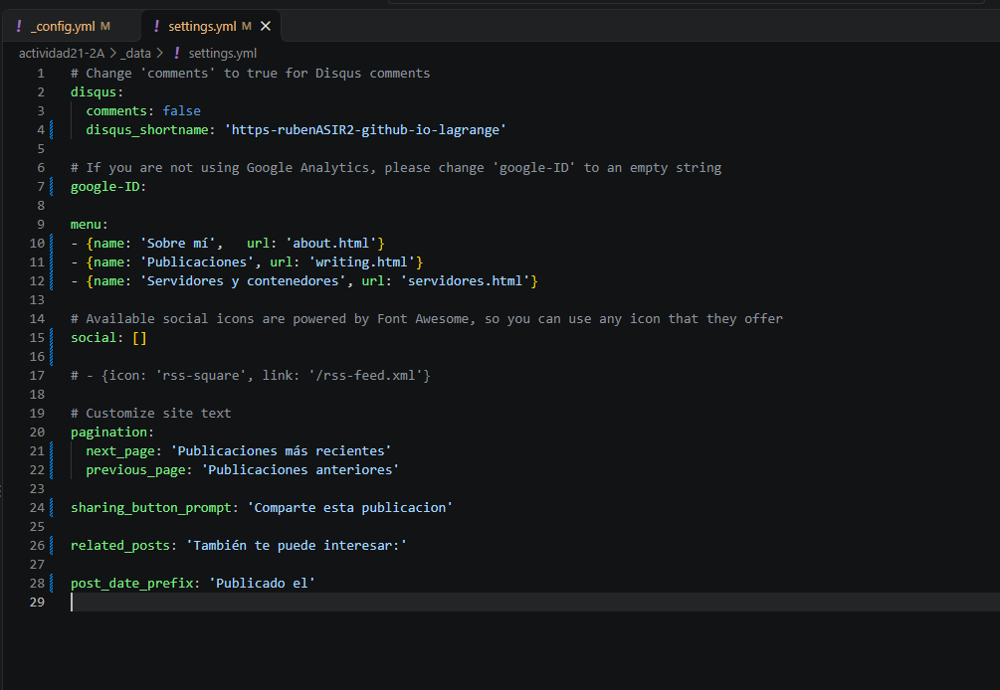

### 2.3. Personalizar la página principal

El archivo `index.html` de Lagrange utiliza el layout `home`, que se encarga de mostrar las publicaciones del blog.

Primero compruebo su contenido:

```bash
cat index.html
```

Mantengo su estructura original:

```yaml
---
layout: home
title: Home
---
```

Para añadir una presentación personalizada, abro el archivo:

```bash
nano _layouts/home.html
```

Justo después del bloque inicial de configuración y antes del bucle de publicaciones:

```liquid

```

añado el siguiente bloque HTML:

```html
<div class="home-intro">
  <h2>Bienvenido a mi blog</h2>

  <p>
    Soy estudiante de segundo curso de ASIR y en este blog
    documento las prácticas relacionadas con la administración
    de servidores web, contenedores y despliegue de aplicaciones.
  </p>

  <p>
    Las principales tecnologías que utilizo son Linux,
    Apache, Nginx, Docker y Git.
  </p>
</div>
```

No elimino el resto del código del layout, ya que contiene la estructura que genera automáticamente el listado de publicaciones.

De esta forma, la portada mostrará mi presentación y las entradas del blog.

**Captura 5. Personalización de la página principal.**

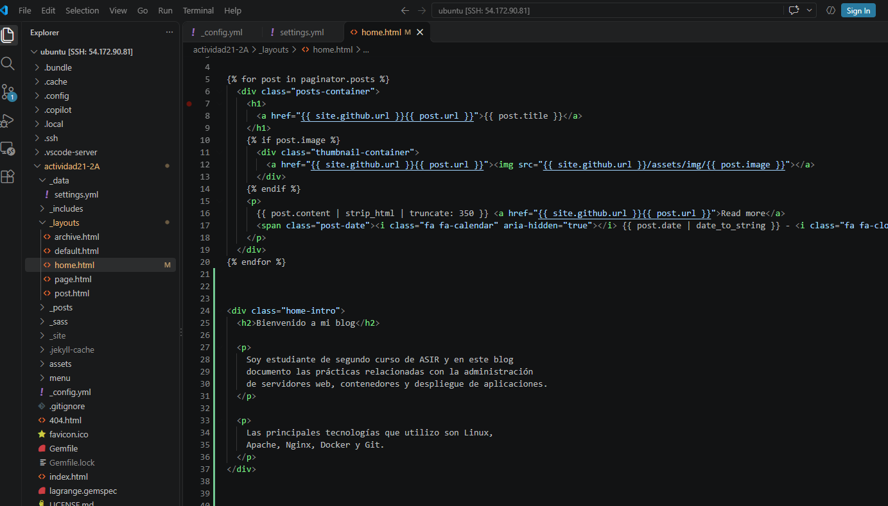

### 2.4. Personalizar la página «Sobre mí»

Abro el archivo de presentación personal:

```bash
nano menu/about.md
```

Sustituyo su contenido por:

```markdown
---
layout: page
title: Sobre mí
permalink: /about.html
---

# Sobre mí

Soy estudiante de segundo curso de Administración de Sistemas
Informáticos en Red (ASIR), después de haber completado el ciclo
de Sistemas Microinformáticos y Redes (SMR).

En este blog documento las prácticas que realizo durante
mi formación, principalmente sobre administración de
servidores web, contenedores y despliegue de aplicaciones.

## Tecnologías con las que trabajo

- Linux y Ubuntu Server.
- Apache.
- Nginx.
- Docker.
- Git y GitHub.

El objetivo es recopilar los procedimientos realizados,
documentar las configuraciones y disponer de una referencia
de los conocimientos adquiridos durante el ciclo.


```

Esta página utiliza el layout `page` e incorpora una imagen relacionada con la temática del blog.

Guardo los cambios.

**Captura 6. Personalización de la página Sobre mí.**

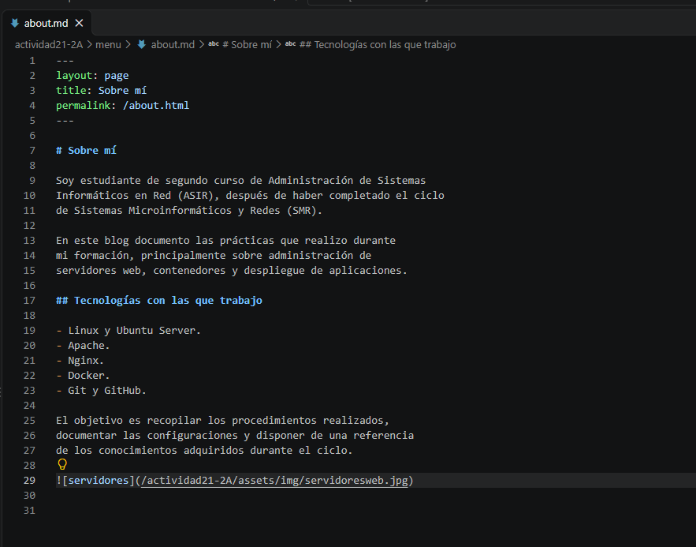

### 2.5. Configurar la página de publicaciones

Abro el archivo encargado de mostrar el listado de entradas:

```bash
nano menu/writing.md
```

Dejo su contenido de esta forma:

```markdown
---
layout: archive
title: Publicaciones
permalink: /writing.html
---
```

El layout `archive` genera automáticamente el listado de publicaciones del directorio `_posts`.

No necesito añadir manualmente los enlaces a cada entrada.

### 2.6. Crear una página adicional

Creo una nueva página dedicada a las tecnologías utilizadas en mis prácticas:

```bash
nano menu/servidores.md
```

Introduzco:

```markdown
---
layout: page
title: Servidores y contenedores
permalink: /servidores.html
---

# Servidores web y contenedores

En este apartado recopilo las principales tecnologías
que utilizo durante mis prácticas de ASIR.

## Servidores web

Los servidores web permiten publicar páginas y aplicaciones
para que puedan consultarse mediante un navegador.

Durante las prácticas he trabajado con:

- **Apache:** instalación y configuración en Ubuntu Server.
- **Nginx:** despliegue y comparación con Apache.

## Contenedores Docker

Docker permite ejecutar aplicaciones y servicios de forma
aislada mediante contenedores.

He realizado un primer despliegue de Nginx utilizando
su imagen oficial y configurando la publicación de puertos.

## Despliegue de aplicaciones

También trabajo con Git y GitHub para gestionar los proyectos
y mantener un control de versiones de los archivos.


```

Guardo el archivo.

Esta página aparecerá en el menú gracias a la configuración realizada en `_data/settings.yml`.

**Captura 7. Creación de la página Servidores y contenedores.**

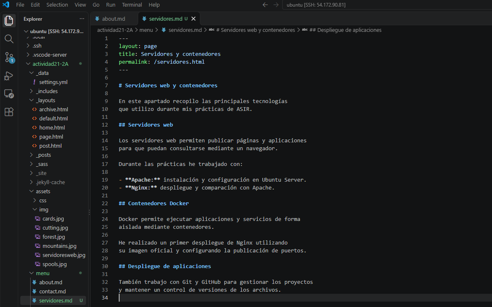

### 2.7. Crear las publicaciones del ejercicio 1A

Las publicaciones se almacenan dentro del directorio `_posts`.

Voy a mantener la misma temática y las fechas del ejercicio 1A para dar continuidad al contenido del blog.

Primero compruebo el directorio:

```bash
ls _posts
```

Elimino las publicaciones de demostración del creador original que no vaya a utilizar.

A continuación, creo las tres entradas.

#### Primera publicación: instalar Apache en Ubuntu Server

Creo el archivo:

```bash
nano _posts/2026-10-01-instalar-apache-ubuntu-server.md
```

Contenido:

```markdown
---
layout: post
title: "Instalar Apache en Ubuntu Server"
author: "NOMBRE APELLIDOS"
categories: [Servidores web]
tags: [Linux, Apache, Ubuntu]
image: apache-ubuntu.jpg
---

# Instalar Apache en Ubuntu Server

En esta práctica he trabajado con la instalación y configuración
inicial del servidor web Apache en Ubuntu Server.

Apache permite servir páginas y aplicaciones web mediante
el protocolo HTTP.

## Instalación

Actualizo los repositorios e instalo el servicio:

```bash
sudo apt update
sudo apt install apache2
```

## Iniciar el servicio

Habilito Apache para que arranque automáticamente
y lo inicio en el sistema:

```bash
sudo systemctl enable --now apache2
```

## Comprobación

Compruebo el estado del servicio:

```bash
systemctl status apache2
```

También realizo una petición HTTP:

```bash
curl -I http://localhost
```

## Conclusión

Con esta práctica he aprendido a instalar y administrar
un servidor web Apache en Ubuntu Server y a comprobar
su funcionamiento mediante comandos de Linux.
```

#### Segunda publicación: Apache frente a Nginx

Creo el archivo:

```bash
nano _posts/2026-10-08-apache-frente-a-nginx.md
```

Contenido:

```markdown
---
layout: post
title: "Apache frente a Nginx"
author: "NOMBRE APELLIDOS"
categories: [Servidores web]
tags: [Apache, Nginx, Linux]
image: apache-nginx.jpg
---

# Apache frente a Nginx

En esta práctica he realizado una comparación entre Apache
y Nginx, dos de los servidores web más utilizados en Linux.

Ambos permiten servir contenido web, pero presentan diferencias
en su arquitectura y en la gestión de las conexiones.

## Comparativa

| Característica | Apache | Nginx |
|---|---|---|
| Modelo | Procesos e hilos mediante MPM | Arquitectura basada en eventos |
| Configuración | Permite utilizar `.htaccess` | Configuración centralizada |
| Contenido estático | Buen rendimiento | Muy eficiente |

## Apache

Apache permite utilizar módulos y archivos `.htaccess`
para establecer determinadas reglas de configuración
por directorio, siempre que esté permitido.

## Nginx

Nginx utiliza una arquitectura basada en eventos que permite
gestionar un gran número de conexiones concurrentes.

También se utiliza habitualmente como servidor web y
como proxy inverso.

## Conclusión

Ambos servidores son alternativas válidas.
La elección depende de las necesidades del proyecto,
la configuración y el tipo de servicio que se quiera desplegar.
```

#### Tercera publicación: mi primer contenedor Docker

Creo el archivo:

```bash
nano _posts/2026-10-15-mi-primer-contenedor-docker.md
```

Contenido:

```markdown
---
layout: post
title: "Mi primer contenedor Docker"
author: "NOMBRE APELLIDOS"
categories: [Contenedores]
tags: [Docker, Nginx, Linux]
image: docker-nginx.jpg
---

# Mi primer contenedor Docker

En esta práctica he realizado un primer despliegue de un servidor
web Nginx utilizando Docker.

Los contenedores permiten ejecutar aplicaciones de forma aislada
sin tener que instalar directamente todos sus componentes
en el sistema anfitrión.

## Arrancar el contenedor

Utilizo la imagen oficial de Nginx mediante el siguiente comando:

```bash
docker run -d --name web -p 8080:80 nginx
```

El comando ejecuta Nginx en segundo plano, asigna el nombre
web al contenedor y publica el puerto 80 del contenedor
en el puerto 8080 del equipo anfitrión.

## Comprobar el contenedor

Compruebo que está en funcionamiento:

```bash
docker ps
```

## Comprobar el servidor web

Realizo una petición HTTP:

```bash
curl -I http://localhost:8080
```

También puedo abrir desde el navegador:

```text
http://localhost:8080
```

Si todo funciona correctamente, aparece la página
de bienvenida de Nginx.

## Conclusión

Con esta práctica he realizado mi primer despliegue
de un servidor web utilizando Docker y he comprobado
el funcionamiento de la publicación de puertos.
```

Las tres publicaciones siguen el formato de nombres que utiliza Jekyll:

```text
AAAA-MM-DD-nombre-de-la-publicacion.md
```

Conservo las fechas originales del ejercicio 1A para mantener el mismo orden cronológico.

**Captura 8. Creación de las publicaciones.**

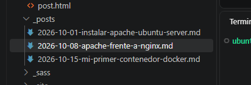

### 2.8. Añadir imágenes a las páginas y publicaciones

Para incorporar imágenes, utilizo el directorio `assets/img` del tema.

Compruebo si existe:

```bash
ls assets/img/
```

Si no existe, lo creo:

```bash
mkdir -p assets/img
```

Voy a utilizar cuatro imágenes relacionadas con las prácticas:

| Archivo | Utilización |
|---|---|
| `servidores-web.jpg` | Página Sobre mí |
| `apache-ubuntu.jpg` | Publicación de Apache |
| `apache-nginx.jpg` | Comparación de servidores |
| `docker-nginx.jpg` | Página y publicación de Docker |


**Captura 9. Imágenes incorporadas al proyecto.**

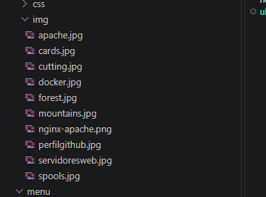

---

## 3. Comprobar el funcionamiento en local

Antes de publicar el sitio, compruebo que las páginas, las publicaciones, las imágenes y los estilos funcionan correctamente.

Como Lagrange utiliza `site.github.url` para construir las rutas de los recursos, creo una configuración temporal para visualizarlo en localhost.

Creo el archivo fuera del repositorio:

```bash
nano /tmp/lagrange-local.yml
```

Introduzco:

```yaml
url: "http://localhost:4000"
baseurl: ""

github:
  url: "http://localhost:4000"
```

Arranco el servidor utilizando las dos configuraciones:

```bash
bundle exec jekyll serve --config _config.yml,/tmp/lagrange-local.yml
```

Abro el navegador:

```text
http://localhost:4000
```

Compruebo que la portada, el menú, las páginas, las publicaciones y las imágenes se muestran correctamente.

Cuando termino la comprobación, detengo el servidor con `Ctrl + C`.

**Captura 10. Blog funcionando en local.**

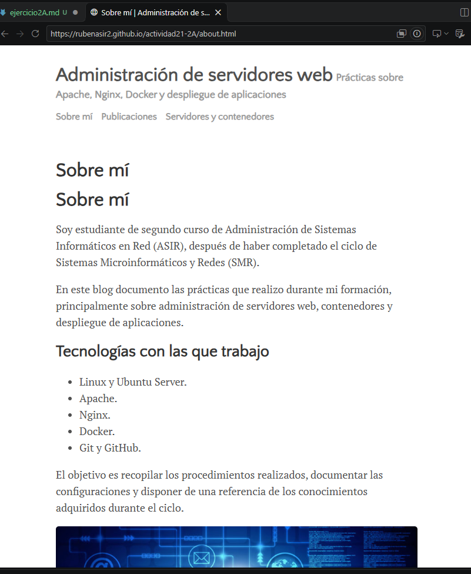

**Captura 11. Comprobación de publicaciones e imágenes.**

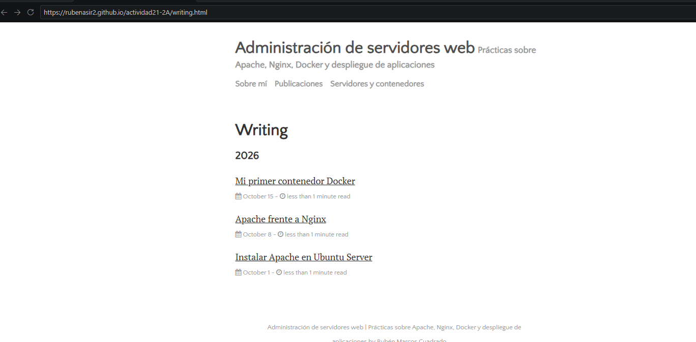

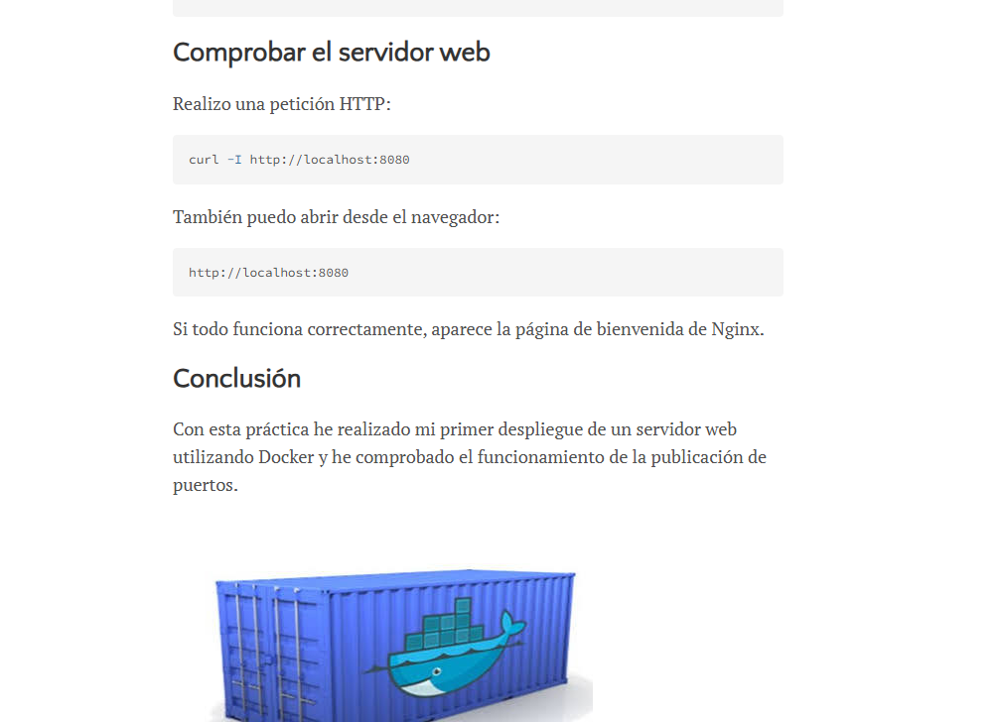

---

## 4. Generar el sitio estático en el directorio docs

Una vez comprobado el funcionamiento local, preparo la versión que voy a publicar mediante GitHub Pages.

El enunciado indica que Jekyll debe compilarse en el equipo local y que la salida habitual `_site` debe generarse en `docs`.

Accedo a la raíz del proyecto:

```bash
cd ~/actividad21-2A
```

Genero la versión de producción directamente en `docs`:

```bash
JEKYLL_ENV=production bundle exec jekyll build --destination docs
```

El parámetro `--destination docs` indica a Jekyll que utilice esa carpeta como destino de la compilación.

Compruebo que se ha generado la página principal:

```bash
ls docs/index.html
```

Compruebo también los recursos:

```bash
ls docs/assets/css/
ls docs/assets/img/
```

Y las páginas:

```bash
ls docs/about.html
ls docs/writing.html
ls docs/servidores.html
```

### 4.1. Crear el archivo `.nojekyll`

Como el sitio ya está compilado localmente, creo el archivo `.nojekyll` dentro de `docs`:

```bash
touch docs/.nojekyll
```

Este archivo indica a GitHub Pages que no debe volver a procesar el sitio mediante Jekyll.

Compruebo que se ha creado:

```bash
ls -la docs/
```

**Captura 12. Compilación del sitio en docs.**

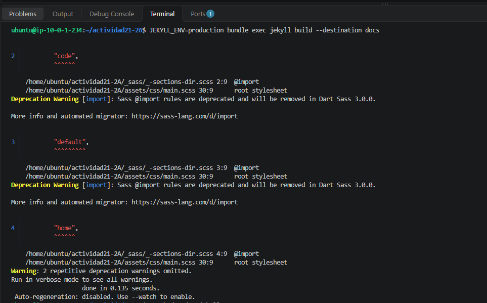

**Captura 13. Contenido de docs y archivo .nojekyll.**

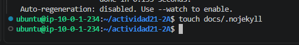

### 4.2. Comprobar las rutas de los recursos

Antes de publicar, compruebo que los estilos y las imágenes están incluidos en la compilación.

Ejecuto:

```bash
grep -n "assets/css/main.css" docs/index.html
```

La ruta generada debe apuntar al repositorio de GitHub Pages:

```text
https://USUARIO.github.io/actividad21-2A/assets/css/main.css
```

Compruebo también las imágenes:

```bash
find docs/assets/img/ -type f
```

Así verifico que los recursos están presentes antes de subirlos a GitHub.

---

## 5. Publicar el sitio mediante GitHub Pages

Cuando la compilación está terminada, subo los cambios al repositorio y configuro GitHub Pages para que publique la carpeta `docs`.

### 5.1. Subir los cambios a GitHub

Desde la raíz del proyecto compruebo el estado del repositorio:

```bash
git status
```

Compruebo que estoy trabajando en la rama `main`:

```bash
git branch
```

Si fuera necesario, cambio el nombre de la rama:

```bash
git branch -M main
```

Añado los archivos modificados y los generados:

```bash
git add .
```

Registro los cambios:

```bash
git commit -m 
```

Subo el contenido al repositorio remoto:

```bash
git push -u origin main
```

Una vez terminado, entro en GitHub y compruebo que aparece la carpeta `docs` con los archivos generados.

**Captura 14. Repositorio actualizado en GitHub.**

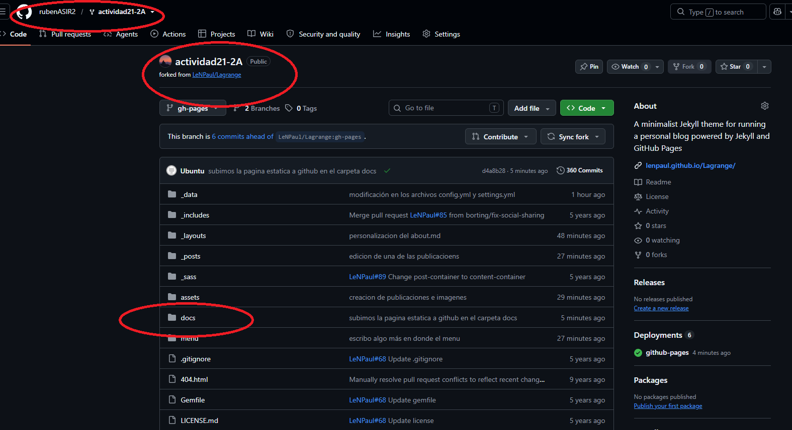

### 5.2. Configurar GitHub Pages

Desde el repositorio `actividad21-2A` sigo estos pasos:

1. Entro en **Settings**.
2. Accedo al apartado **Pages**.
3. En **Build and deployment**, selecciono **Deploy from a branch**.
4. En la rama selecciono `main`.
5. En la carpeta selecciono `/docs`.
6. Pulso **Save**.

De esta manera, GitHub Pages utilizará directamente los archivos estáticos que he generado en local.

El archivo `.nojekyll` evita que se vuelva a aplicar el procesamiento de Jekyll.

**Captura 15. Configuración de GitHub Pages.**

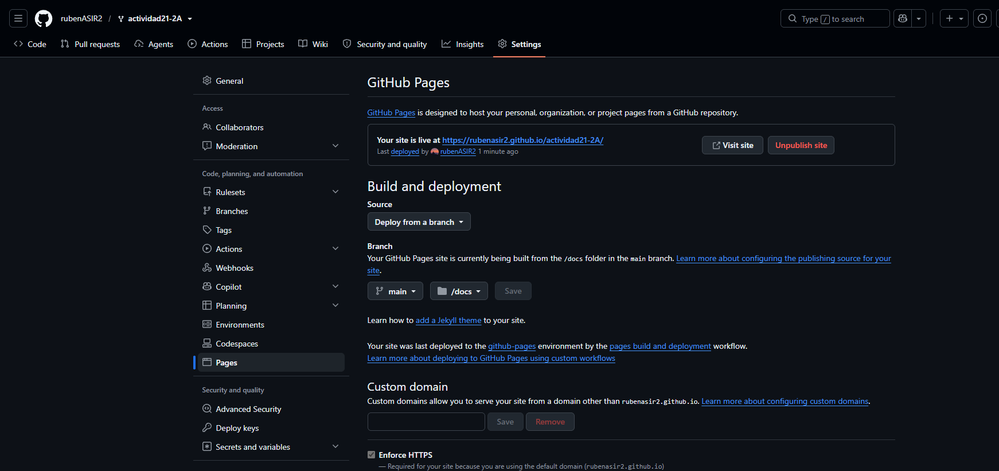

### 5.3. Comprobar la publicación

Una vez guardada la configuración, accedo a la dirección del sitio:

```text
https://rubenasir2.github.io/actividad21-2A/
```

Sustituyo `USUARIO` por mi nombre de usuario de GitHub.

Compruebo que el sitio se publica correctamente y que funcionan las diferentes secciones.

**Captura 16. Página principal publicada.**

!

**Captura 17. Página Sobre mí.**

<!-- INSERTAR CAPTURA 17: presentación personal -->

**Captura 18. Página Servidores y contenedores.**

<!-- INSERTAR CAPTURA 18: página adicional con imagen -->

**Captura 19. Listado de publicaciones.**

<!-- INSERTAR CAPTURA 19: las tres entradas del blog -->

**Captura 20. Publicación de Apache en Ubuntu Server.**

<!-- INSERTAR CAPTURA 20: entrada de Apache con imagen -->

**Captura 21. Publicación Apache frente a Nginx.**

<!-- INSERTAR CAPTURA 21: comparativa y tabla -->

**Captura 22. Publicación Mi primer contenedor Docker.**

<!-- INSERTAR CAPTURA 22: entrada de Docker con imagen y comandos -->

---

## 6. Conclusiones

Con esta práctica he trabajado con la importación y personalización del tema Lagrange para crear un blog mediante Jekyll y GitHub Pages.

He modificado la configuración del sitio, personalizado la página principal y la sección Sobre mí, y añadido una página adicional dedicada a servidores web y contenedores.

También he incorporado las tres publicaciones del ejercicio 1A, manteniendo su temática sobre Apache, Nginx y Docker, junto con imágenes relacionadas con las prácticas.

Por último, he generado el sitio estático en local utilizando `docs` como directorio de salida y he configurado GitHub Pages para publicar esa carpeta desde la rama `main`.

De esta forma, GitHub no realiza la compilación de Jekyll, sino que publica directamente los archivos estáticos generados previamente en mi equipo.

Esta práctica me ha permitido profundizar en la personalización de temas de Jekyll, la gestión de repositorios Git y el despliegue de sitios web estáticos mediante GitHub Pages.